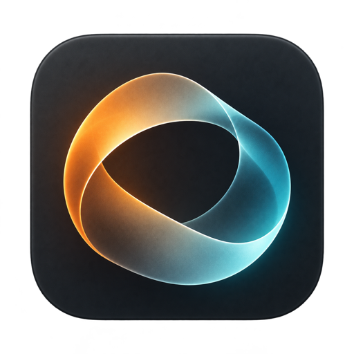
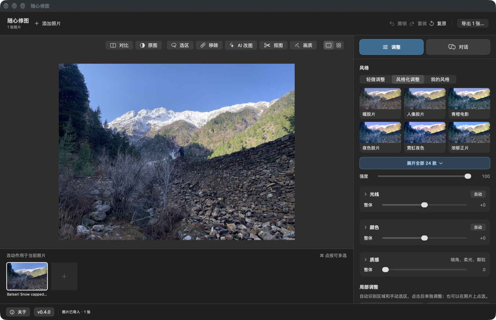
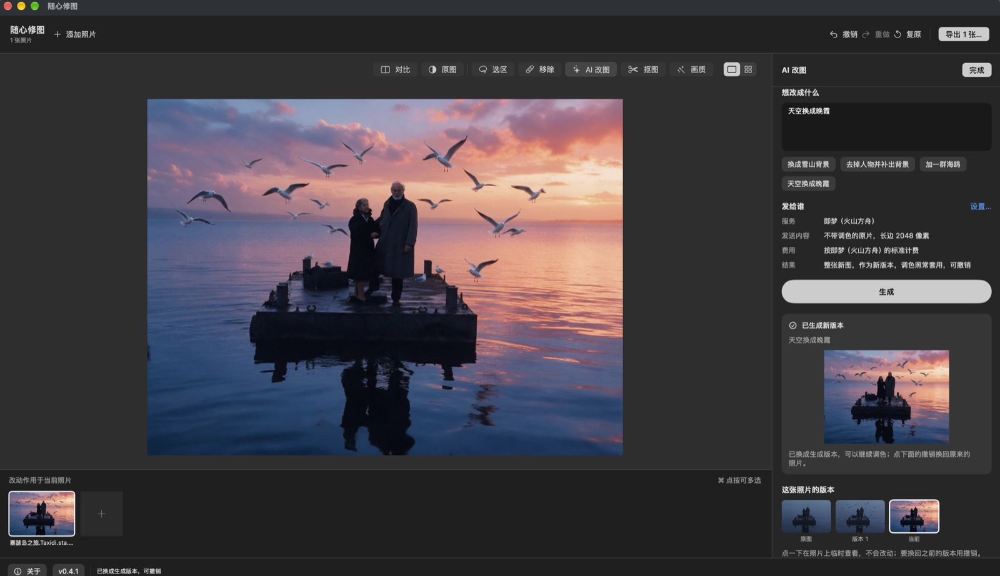
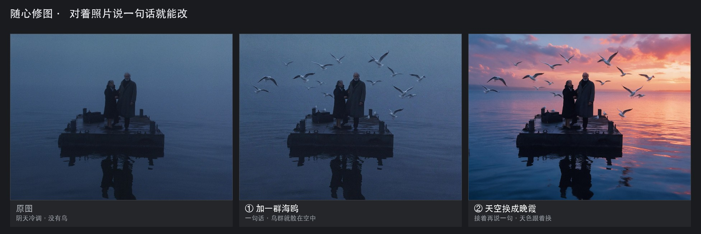

<div align="center">



# 随心修图

**SuiTone**，用对话修图的 macOS 应用

说出想要的效果，AI 把它变成可以继续调整的参数<br>
也可以自己拖滑块、选风格、框选局部。原片始终不动


</div>

随心修图是一款面向 Mac 的本地修图应用。和大多数「一句话生成一张新图」的工具不同，这里的 AI 只做一件事：把你想要的效果翻译成调色参数——曝光、对比、色温、局部区域、质感。参数落在照片旁边的调整记录里，你随时可以接着改、撤销、对比，或者换一套风格再试。

所以 AI 出错也不会毁掉照片。它给的是一组你能看懂的数值，不是一个无法还原的结果。

调色、分区识别、去杂物、放大全部在本机推理，照片不上传。只有你主动使用「对话」并确认发送预览图时，缩小后的预览才会发给你自己配置的 AI 服务。

<div align="center">

</div>

## 可以做什么

- **对话调整**：用日常的话描述效果，例如「把水面压暗一点，人脸的暖光留住」。AI 返回一条或多条参数方案，点一下就能在照片上看效果，不满意可换一条或直接撤销。
- **手动调色**：34 款预设风格分「轻微调整」和「风格化调整」两组，另有光线、颜色、质感三组总滑块，以及白点、黑点、对比等细项。
- **局部区域**：自动识别水、天空、人物、土地等区域，单独调整其中一块的曝光和颜色；也可以手动画选区。
- **修复与画质**：框选或点选杂物后自动移除，抠出主体存为透明 PNG，降噪，2 倍 / 4 倍放大。
- **参考图匹配**：把喜欢的照片放进参考位，应用会算出两张的差异，自动定强度（通常在 45%–80%）并说明理由。
- **AI 改图**：换背景、加内容这类「必须重新画」的需求，配置出图服务后按整张或按选区生成，结果作为新版本存放，不影响原图。
- **多版本与对比**：每次调整都是一个版本，可左右滑动对比，可随时退回任意一步。
- **裁切与旋转**：向左／向右转 90°，左右或上下镜像，自由旋转微调角度，八种常用比例；画面上直接拖框，按回车生效。
- **图集与历史**：导过的每一批照片都留成一条图集，关掉应用再打开自动接着上次那批；每次调色、套风格、AI 改图也各记一条历史，点哪条回到哪一步，不想要的单条删掉就行。
- **RAW 与出片信息**：直接读 DNG / CR2 / NEF / ARW，保留高光余量；可以给照片底部加一条 EXIF 出片信息条。
- **导出**：导出为新文件，不覆盖原片；单张直接放进所选文件夹，多张自动收进一个 `SuiTone-时间` 文件夹；也可以把当前调色学成 3D LUT（`.cube`）带到达芬奇里用。

### AI 改图是怎么工作的

AI 改图和上面的调色面板是两个界面。切到「AI 改图」后，右边写清想要什么、选好出图服务，点生成；生成结果直接落成这张照片的一个新版本，右下角就是它已经攒下的几个版本。

<div align="center">

</div>

同一张照片，连着说两句话，每一步都能单独撤销：

<div align="center">

</div>

生成结果会作为这张照片的新版本存下来，原图不动；你的调色参数继续套在最新版本上。不满意就撤销，回到上一步。

## 支持的 AI 服务

对话需要能看图的模型。可以用本机已经登录的命令行工具，也可以填自己的 API 密钥——密钥存在本机钥匙串，不写进任何文件。

| 类型 | 服务 | 说明 |
| --- | --- | --- |
| 本机账号 | Codex | 需自行安装并登录 Codex CLI，订阅与额度由 OpenAI 账户决定 |
| 本机账号 | Claude Code | 需自行安装并登录 Claude Code CLI |
| 本机账号 | WorkBuddy / CodeBuddy | 需安装并登录 CodeBuddy Code，当前接入固定使用 `glm-5v-turbo` |
| 自备 API | Claude | 原生接口 |
| 自备 API | OpenAI、Gemini、通义千问、豆包、DeepSeek、智谱、Kimi | 走 OpenAI 兼容层，设置里的「测试连接」可拉服务商的模型列表 |
| 自备 API | 自定义地址 | 任何 OpenAI 兼容的接口 |

**一个提醒**：连接成功不代表模型能看图。设置里「连接测试」和「看图测试」是两回事，只有后者通过，对话才真的能修图。

### AI 改图能带几张参考图

生成新画面时除了照片本身，还可以带参考图（姿势、风格、物品）。张数按服务商官方文档来，应用里会按你选的模型显示还能加几张，超出就加不上去：

| 服务 | 模型 | 一次请求最多图片数（含原图） |
| --- | --- | --- |
| 即梦（火山方舟） | Seedream 5.0 pro / 5.0 flash | 10 张 |
| 即梦（火山方舟） | Seedream 5.0 lite / 4.5 / 4.0 | 14 张 |
| Gemini | gemini-2.5-flash-image | 3 张 |
| Gemini | Nano Banana 2.1 / Gemini 3 Pro Image | 14 张 |

数字来自[火山方舟图片生成 API](https://www.volcengine.com/docs/82379/1541523)和 Gemini 的模型规格，改代码时按官方文档更新，不要自行放宽。

## 系统要求

- macOS 14 Sonoma 或更新版本
- Apple 芯片（M1 及更新）。Intel 机器可以装，但尚未在 Intel 上做验收，速度和效果都没有实测数据
- 磁盘约 700 MB（安装包版本，引擎和模型都在包内）
- 下载安装包时需要联网；装好之后调色、识别、导出全程离线，只有用 AI 对话和检查更新时才联网

## 安装

### 方式一：下载安装包（推荐）

1. 在 [Releases](https://github.com/chenmozhe008/SuiTone/releases/latest) 下载 `SuiTone-<版本>-arm64.zip`（约 450 MB），双击解压
2. 把解压出来的「随心修图」拖进「应用程序」文件夹
3. 首次打开时，系统可能提示「无法验证开发者」（本应用未做 Apple 公证）。点「完成」，到「系统设置 → 隐私与安全性」，在页面下方点「仍要打开」；也可以在终端运行一次：

   ```bash
   xattr -dr com.apple.quarantine /Applications/随心修图.app
   ```

安装包里已经带了修图引擎和全部模型，不需要装 Python、不需要编译、不需要额外下载。打开就能用。

### 方式二：一行命令（自己跟进代码）

打开「终端」，粘贴下面这行回车：

```bash
curl -fsSL https://raw.githubusercontent.com/chenmozhe008/SuiTone/master/script/install.sh | bash
```

脚本会自动完成这些事，并打开应用：

1. 检查系统版本、芯片和 Xcode 命令行工具（缺命令行工具时先运行 `xcode-select --install`）
2. 找 Python 3.10 以上版本，没有就用 Homebrew 装一个
3. 把源码放到 `~/SuiTone`，建好虚拟环境并安装依赖
4. 下载 AI 模型（约 420 MB）
5. 编译应用，安装到「应用程序」文件夹

第一次大约 5–15 分钟，取决于网速。再次运行同一个命令就是更新。这条路适合想自己改代码的人；只是想用的话，装方式一的包就可以。

不想下模型（分区、去杂物、放大会不可用，调色和导出照常）：

```bash
curl -fsSL https://raw.githubusercontent.com/chenmozhe008/SuiTone/master/script/install.sh | bash -s -- --no-models
```

国内网络下载模型慢，可以先设代理：

```bash
export https_proxy=http://127.0.0.1:7897
curl -fsSL https://raw.githubusercontent.com/chenmozhe008/SuiTone/master/script/install.sh | bash
```

默认装到「应用程序」。想装到别处用 `--prefix <目录>`，想指定源码目录用 `--src <目录>`。

如果上面那行拉不到脚本（GitHub 国内访问受限），改成先克隆再本地执行，效果一样：

```bash
git clone https://github.com/chenmozhe008/SuiTone.git ~/SuiTone
bash ~/SuiTone/script/install.sh
```

### 方式三：让 AI 助手帮你装

用 Claude Code、Codex、WorkBuddy 这类助手时，把下面这段发给它：

> 请帮我安装「随心修图」（https://github.com/chenmozhe008/SuiTone）：优先从 https://github.com/chenmozhe008/SuiTone/releases/latest 下载 `SuiTone-<版本>-arm64.zip`，解压后把「随心修图.app」放进 /Applications，再运行 `xattr -dr com.apple.quarantine "/Applications/随心修图.app"`。装好后告诉我怎么导入第一张照片。

<details>
<summary>给 AI 助手的说明</summary>

- 安装包是自包含的：`Contents/Resources/engine-bin` 里是引擎，`Contents/Resources/models` 里是模型，运行时通过 `PHOTO_EDIT_ASSETS` 指向包内，不要把模型拷到别处
- 应用为临时签名（ad-hoc），未做 Apple 公证，所以需要清一次隔离属性，或让用户在「隐私与安全性」里点「仍要打开」
- 用户数据在 `~/Library/Application Support/SuiTone`（会话与版本），卸载时连它一起删
- 如果用户想改代码，改用源码方式：`script/install.sh`（虚拟环境 `~/.cache/photo-edit/venv`，模型 `~/.cache/photo-edit/{segformer,lama,sr}`）
- 验证：`codesign --verify --strict "/Applications/随心修图.app"`，`pgrep -x SuiTone` 有输出

</details>

### 方式四：从源码构建（开发者）

```bash
git clone https://github.com/chenmozhe008/SuiTone.git
cd SuiTone
./script/install.sh --src "$PWD"          # 建环境、下模型、编译、安装

./script/build_and_run.sh --build-only    # 只编译到 dist/SuiTone.app
./script/build_and_run.sh --verify        # 编译、启动并确认进程存活
./script/test.sh                          # Swift 与 Python 测试
./script/package_release.sh               # 打自包含发行包（需 pyinstaller 与模型）
```

引擎是纯 Python，可以单独调用。命令行入口见 `engine/cli.py`，模块说明和模型下载地址见 [`engine/README.md`](engine/README.md)。发行包里引擎用 PyInstaller 打包成独立可执行文件，模型随包分发，运行时通过 `PHOTO_EDIT_ASSETS` 指定资源目录。

## 首次使用

1. 启动应用，把照片拖进窗口，或点「+ 添加照片」。导入时不会自动改照片。
2. 右侧「调整」里先试风格：点缩略图即可预览，滑块决定强度。
3. 想用文字修图，切到「对话」，在「设置 → 对话和看图」里选一个 AI 服务，同意发送预览图后描述你想要的效果。
4. 要换背景或加东西，用「AI 改图」：先画选区（可选），写要求，确认发送内容和费用提示后生成。
5. 「导出」生成新照片；「保存调整记录」保留可继续编辑的工程。

| 快捷键 | 作用 |
| --- | --- |
| ⌘O | 导入照片 |
| ⇧⌘R | 添加参考图 |
| ⌘, | 打开设置 |
| ⌘Z / ⇧⌘Z | 撤销 / 重做 |
| \ | 按住对比原图 |
| ⌘K | 保存快照 |
| ⌘S | 保存调整记录 |
| ⇧⌘E | 导出照片 |
| ⌘R | 打开「移除杂物」 |
| ⌘A | 选中全部照片 |

导入多张照片时按住 Command 在照片条里多选，调整会作用到所选照片；风格缩略图以选中的第一张为例。

## 数据与隐私

- **照片不出本机**：调色、分区识别、去杂物、放大全部在本机用 ONNX 推理完成，没有上传代码。
- **只在同意后发送**：对话和 AI 改图需要把图发给 AI 服务。每个服务第一次使用时会明确提示发送内容，同意后才发送，且发送的是缩小后的预览。
- **密钥进钥匙串**：API 密钥保存在 macOS 钥匙串，不写入配置文件，也不会出现在导出文件里。
- **文件位置**：会话与版本在 `~/Library/Application Support/SuiTone`，模型与 Python 环境在 `~/.cache/photo-edit`，导出的照片由你自己选目录。
- **联网时机**：只在你主动使用 AI 服务，以及检查更新时访问网络（每天最多一次，可在设置里关闭）。

## 能力边界

这些是实测出来的限制，先说清楚，省得你踩坑：

- **4 倍放大**在手机远景上有涂抹感，只适合救急，不适合成片交付。
- **人像**只做肤色保护和轻修饰，不做精修；精修还是交给专业工具。
- **LUT 只认颜色**：同一个颜色映射到同一个颜色，所以分区调色导不进 LUT（灰蓝的水和灰蓝的雾山分不开）。实际做法是导一个底子 LUT，水和天在达芬奇里用 Magic Mask 单独建节点。
- **细小物体**或被模型认错的物体（比如被识别成 building 的信号塔），要用方框 + 「保留天空」这类组合来框，别指望点选一次就中。
- **分区识别是自动的**，动手前建议看一眼遮罩，不对就手动补选区。
- **速度**（M 系列 CPU）：4032px 调色约 10 秒；去杂物每个 640px 窗口约 1 秒。

## 常见问题

**第一次打开提示「无法验证开发者」？**
应用没有做 Apple 公证。在「系统设置 → 隐私与安全性」页面下方点「仍要打开」，或运行 `xattr -dr com.apple.quarantine /Applications/随心修图.app`，之后就可以正常双击打开。

**安装时卡在下载模型？**
模型来自 HuggingFace，国内网络需要代理。设好 `https_proxy` 后重新运行安装命令，已下载的部分会跳过。用安装包的话没有这一步，模型已经在包里。

**提示缺少 Xcode 命令行工具？**
在终端运行 `xcode-select --install`，装完重新执行安装命令。应用是原生 SwiftUI 编译的，必须要有命令行工具。

**提示缺少 Python？**
脚本会尝试用 Homebrew 装 `python@3.12`。没有 Homebrew 的话先装 Homebrew（https://brew.sh）。系统自带的 Python 3.9 太旧，装不了这些依赖。

**打开应用后提示找不到引擎？**
说明 `~/SuiTone` 被删掉或移动了。重新运行安装命令即可恢复；源码目录是运行依赖，不要删。

**为什么第一次安装要十几分钟？**
要装 Python 依赖、下 420 MB 模型、编译 Swift 应用。之后启动只需要一两秒。

**设置里没有我的本机账号？**
确认对应的 CLI 已经安装，并且能在终端里启动。装好后重新打开应用。「已安装」不等于「已登录」。

**WorkBuddy 已经登录了，为什么对话还是不能用？**
安装 WorkBuddy 桌面版不代表 CodeBuddy 命令行已经登录。需要单独安装 CodeBuddy Code 并用同一账号登录。

**导入照片会自动变吗？**
不会。只有你主动点风格、拖滑块或确认 AI 操作后，照片才会变。

**改坏了怎么办？**
每次操作都是独立版本，⌘Z 撤销，或者点版本对比退回任意一步。原图始终没有被修改。

**怎么卸载？**
退出应用，删除 `/Applications/随心修图.app`、`~/SuiTone`、`~/.cache/photo-edit` 和 `~/Library/Application Support/SuiTone`。后两个是模型和会话数据，删掉会连同调整记录一起清空。

## 反馈

- [GitHub Issues](https://github.com/chenmozhe008/SuiTone/issues)
- 邮件：327529709@qq.com
- 应用内「关于 → 反馈」也会生成一封邮件草稿

报问题时请附上系统版本、芯片、应用版本（左下角可见）和复现步骤。反馈里不要贴 API 密钥。

更新记录见 [CHANGELOG.md](CHANGELOG.md)。

## 第三方组件

本应用站在这些项目的肩上：

- [ONNX Runtime](https://onnxruntime.ai)（MIT）：本机推理
- [SegFormer](https://github.com/NVlabs/SegFormer)（ADE20K 分区模型）：水、天空、人物等区域识别
- [LaMa](https://github.com/advimman/lama)（Apache-2.0）：去杂物修补
- [Swin2SR](https://github.com/mv-lab/swin2sr)（Apache-2.0）：2 倍 / 4 倍放大
- [rawpy](https://github.com/letmaik/rawpy)、[OpenCV](https://opencv.org)、[Pillow](https://python-pillow.org)、[NumPy](https://numpy.org)：图像读写与处理

模型不随仓库分发，由安装脚本从各自的原始页面下载。这些模型各自适用其上游许可证，与下文的代码许可证是两件事；用于商业项目前请自行确认相应模型的授权范围。

## 许可证

代码以 [MIT](LICENSE) 发布，© 沉默者之二。
